# Contribution city

One tile per day for the last 12 months. Empty plots are quiet days; taller, brighter buildings are busier days; the violet tower is the busiest day; the cyan outline marks the longest streak. Rebuilt automatically from real GitHub data.

# Now

# Stack

# Projects

<!--START:projects-->

<a href="https://ml-loan-eight.vercel.app">Live demo of ML-Loan</a>

Coursework and practice repositories: <a href="https://github.com/MeetIndoriya/ASP.NET">ASP.NET</a> · <a href="https://github.com/MeetIndoriya/PYTHON">PYTHON</a> · <a href="https://github.com/MeetIndoriya/WEB-TECHNOLOGY-2">WEB-TECHNOLOGY-2</a>
<!--END:projects-->

  <a href="https://github.com/MeetIndoriya">GitHub</a> ·
  <a href="https://www.linkedin.com/in/meet-indoriya">LinkedIn</a> ·
  <a href="https://meetdeveloper.vercel.app">Portfolio</a> ·
  <a href="https://www.instagram.com/meet.indoriya">Instagram</a>

How this profile stays current

 

Everything above except this text is generated. A GitHub Action runs `scripts/build_profile.py` every 12 hours, reads my public GitHub data, redraws the SVGs in `assets/` and commits only when something changed. There are no third-party widgets and no hard-coded statistics. The generator, the workflow and the design tokens are all in this repository if you want to adapt them.

